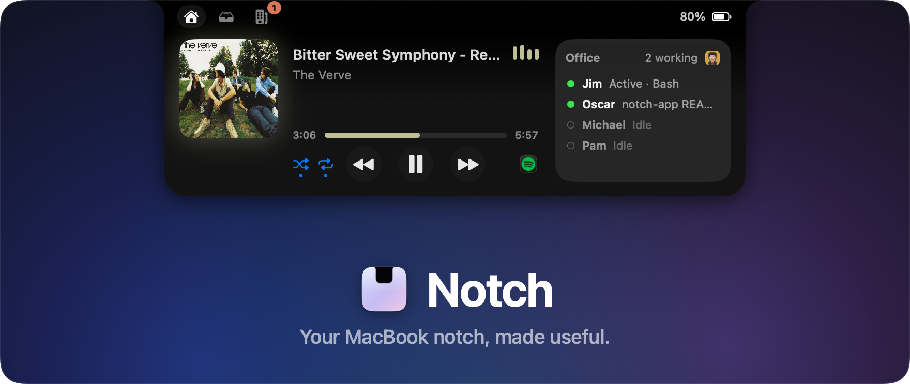
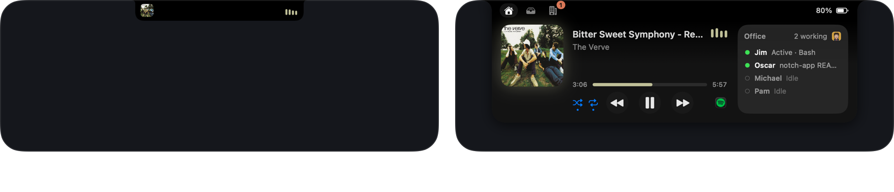
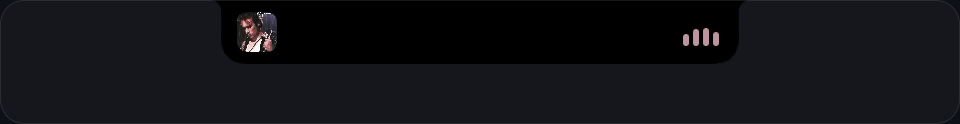
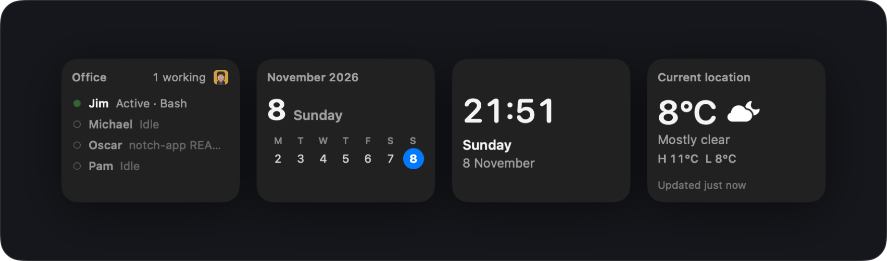
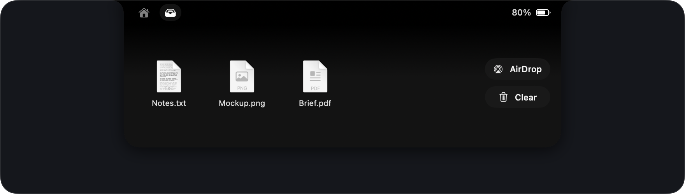
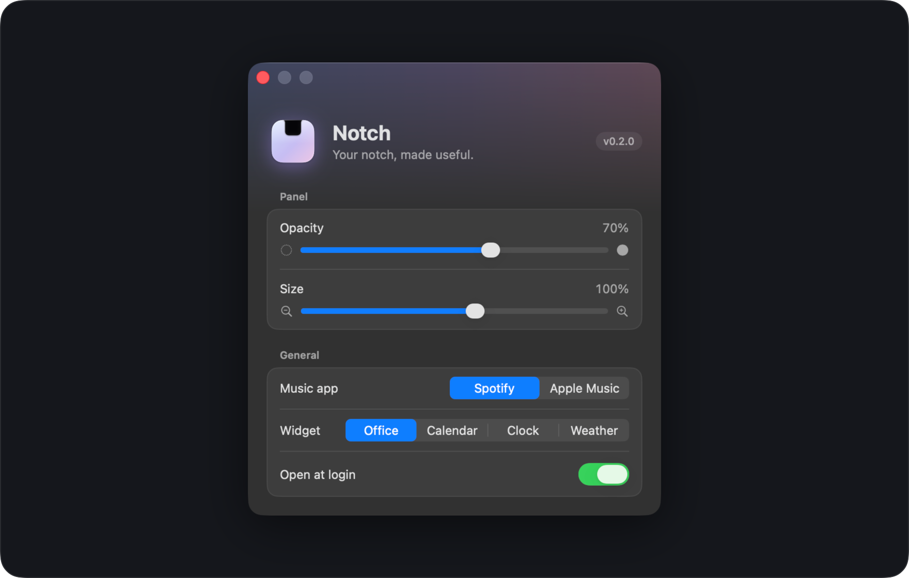

<p align="center">
  
  
  
  
</p>

<p align="center">
  Music, live widgets and a file shelf in a liquid glass panel that grows out of the notch.<br>
  Native SwiftUI, no dependencies.
</p>

<p align="center">
  <a href="#features"><b>Features</b></a> ·
  <a href="#install"><b>Install</b></a> ·
  <a href="#permissions"><b>Permissions</b></a> ·
  <a href="#settings"><b>Settings</b></a>
</p>



## Features

<h3 align="center">🎵 Now playing, with bars that hear the music</h3>
<p align="center">
  Spotify and Apple Music. Artwork, a scrubbable timeline, and shuffle and repeat that turn blue when on.<br>
  The bars follow the real audio, in the album's colour, and cost nothing while paused.<br>
  Plug in, and the closed notch shows a charging pill too.
</p>



<h3 align="center">🧩 One widget, your pick</h3>
<p align="center">
  <b>Office</b> shows your agents live in Munder Difflin, an agent management app.<br>
  Or choose <b>Calendar</b>, <b>Clock</b> or <b>Weather</b> for your city. Only the one you pick runs.
</p>



<h3 align="center">📥 A shelf for files in transit</h3>
<p align="center">
  Drop files on the notch, drag them out where you need them, or AirDrop them all at once.<br>
  The shelf survives relaunches.
</p>



<h3 align="center">↗️ One click to your apps</h3>
<p align="center">
  Buttons open your music app or Munder Difflin, using their real icons. They hide when an app isn't installed.
</p>

## Install

```bash
git clone https://github.com/WillChogls/notch-app.git
cd notch-app && ./build.sh install
```

Notch builds, copies itself to `/Applications` and launches. It lives in the menu bar: click its capsule for **Settings…** and **Quit**.

<details>
<summary><b>Requirements</b></summary>
<br>

- macOS 14 Sonoma or later. macOS 26 gives the full Liquid Glass look; 14–15 use a frosted fallback.
- The real-audio equalizer needs macOS 14.2+; older systems show a simulated beat.
- The Swift toolchain. Command Line Tools is enough (`xcode-select --install`); Xcode is not needed.
- Any Mac works. Without a notch, Notch draws a pill at the top of the screen.

</details>

<details>
<summary><b>Build commands</b></summary>
<br>

| Command | What it does |
|---|---|
| `./build.sh` | Builds `build/Notch.app` (ad-hoc signed) |
| `./build.sh run` | Builds and launches it from `build/` |
| `./build.sh install` | Builds, installs to `/Applications` and launches |

</details>

## Permissions

Notch asks for each permission only when a feature first needs it, and records nothing.

<details>
<summary><b>What it asks for, and why</b></summary>
<br>

| Permission | Asked when | Why |
|---|---|---|
| **Automation** (Music / Spotify) | Notch first sees Spotify or Music playing | To read the track and artwork, and to play, skip, shuffle and repeat |
| **Audio capture** | Music first plays while Notch runs | To listen to the music app only, so the bars move with it. Nothing is recorded or saved. |
| **Location** | You first pick the Weather widget | City-level, for the forecast (weather from [Open-Meteo](https://open-meteo.com)) |

Builds are ad-hoc signed, so macOS may ask again after you rebuild.

</details>

## Settings



<p align="center">
  Panel opacity and size · Music app · Widget · Open at login
</p>

<br>

<p align="center">
  <sub>Swift and SwiftUI, no third-party packages: Liquid Glass via <code>glassEffect</code>, Core Audio process taps for the equalizer, Core Location with Open-Meteo for weather.<br>
  Design specs for every part of the app live in <a href="Resources/design"><code>Resources/design/</code></a>.</sub>
</p>
