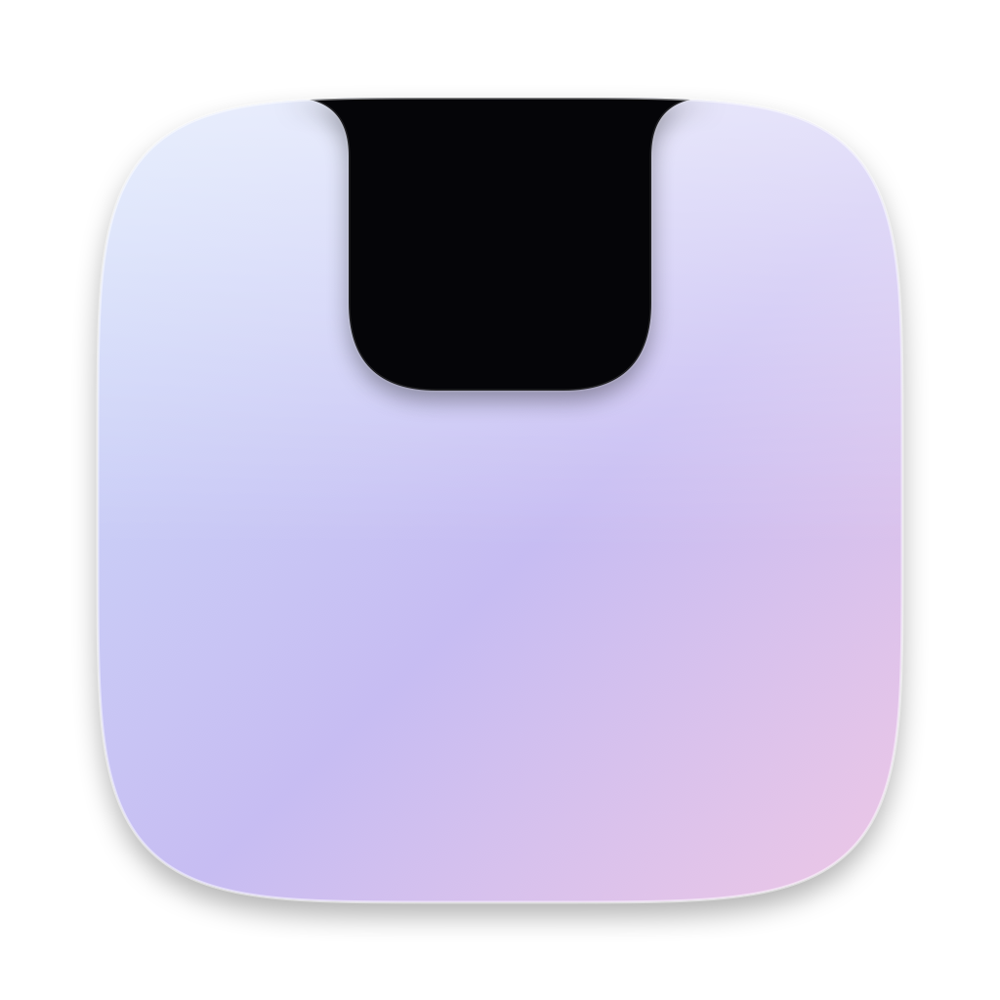
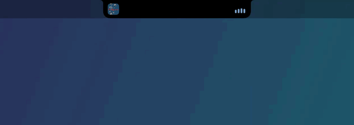
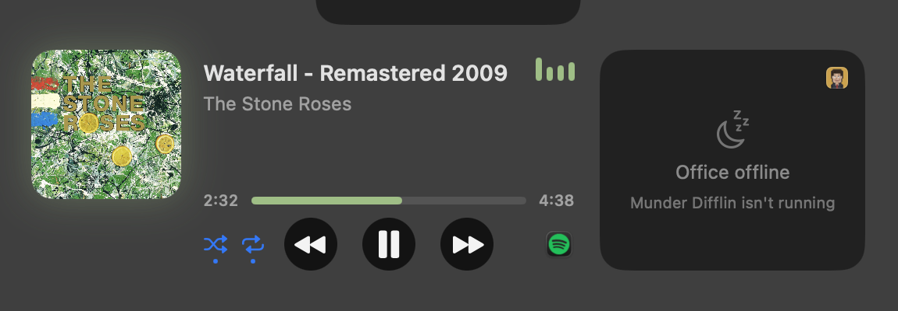
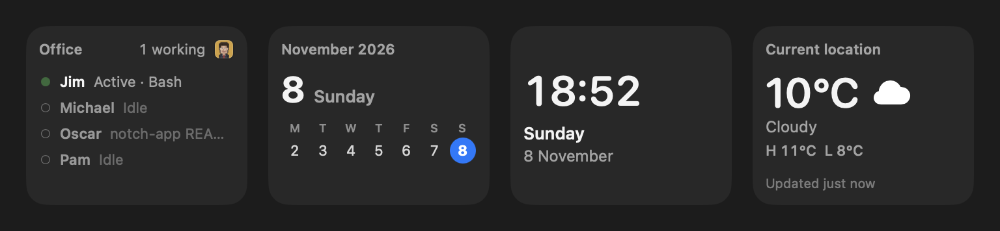
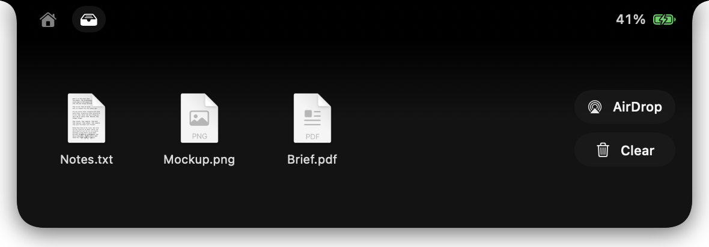
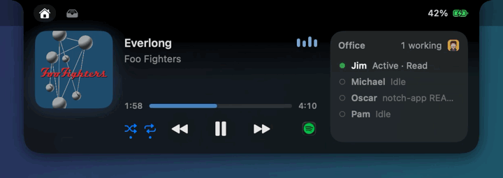
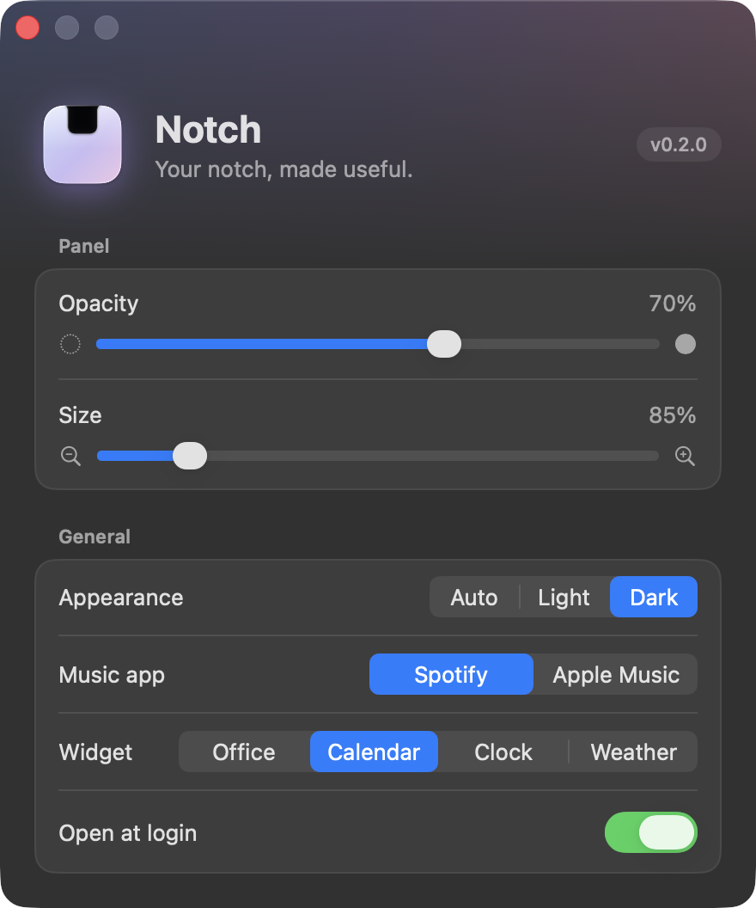

<p align="center">
  
</p>

<h1 align="center">Notch</h1>

<p align="center">
  <b>Your MacBook notch, made useful.</b><br>
  A native SwiftUI “Dynamic Island” for macOS: music, live widgets and a file shelf in a liquid-glass panel that grows out of the notch.
</p>

<p align="center">
  
  
  
  
</p>

<p align="center">
  
</p>

<p align="center">
  <a href="#features">Features</a> ·
  <a href="#demos">Demos</a> ·
  <a href="#install">Install</a> ·
  <a href="#permissions">Permissions</a> ·
  <a href="#settings">Settings</a>
</p>

---

## Features

<table>
<tr>
<td width="50%" valign="top">

### 🫧 Liquid glass panel
Hover the notch and a glass panel springs open from the centre. Its top edge stays black, so it blends into the hardware notch. It follows light and dark mode, and you can set its opacity and size.

</td>
<td width="50%" valign="top">

### 🎚️ Equalizer that hears the music
While a song plays, the closed notch shows the album art and four bars in the album's colour. They react to the real audio of the music app, not to random numbers, and they stop using the processor when the music pauses.

</td>
</tr>
<tr>
<td colspan="2">

<picture>
  <source media="(prefers-color-scheme: light)" srcset="Resources/design/shuffle-repeat-v2-light.png">
  
</picture>

</td>
</tr>
<tr>
<td width="50%" valign="top">

### 🎵 Now playing, Spotify and Apple Music
Artwork, title, a scrubbable progress bar, previous/play/next, and **shuffle and repeat** toggles that light up blue when on.

</td>
<td width="50%" valign="top">

### ↗️ App shortcut buttons
One click opens your music app (you pick Spotify or Apple Music in Settings) or Munder Difflin. The buttons hide when an app isn't installed.

</td>
</tr>
<tr>
<td colspan="2">

### 🧩 One widget slot, your choice
The right-hand card shows the widget you pick: **Office** (what each Munder Difflin agent is doing), **Calendar** (this week, today highlighted), **Clock**, or **Weather** (your city, found automatically).

<picture>
  <source media="(prefers-color-scheme: light)" srcset="Resources/readme/widgets-light.png">
  
</picture>

</td>
</tr>
<tr>
<td width="50%" valign="top">

### 📥 File shelf
Drag files onto the notch to stash them, then drag them back out where you need them. You can also double-click to open them or AirDrop them all. The shelf survives relaunches.



</td>
<td width="50%" valign="top">

### 🔋 Live activities
The closed notch grows small “wings” for what's happening right now: album art and bars while music plays, and a charging pill when you plug in.


</td>
</tr>
</table>

## Demos

| Panel opens from the centre | Bars follow the music | Switching widgets |
|:---:|:---:|:---:|
|  |  |  |

## Install

**Requirements:**
- macOS 14 Sonoma or later. macOS 26 gives the full Liquid Glass look; 14–15 use a frosted fallback.
- The real-audio equalizer needs macOS 14.2+; older systems fall back to a simulated beat.
- The Swift toolchain. Command Line Tools is enough (`xcode-select --install`); Xcode is not needed.
- Any Mac works. Without a notch, Notch draws a pill at the top of the screen.

```bash
git clone https://github.com/WillChogls/notch-app.git
cd notch-app
./build.sh install   # build, copy to /Applications/Notch.app, launch
```

| Command | What it does |
|---|---|
| `./build.sh` | Builds `build/Notch.app` (ad-hoc signed) |
| `./build.sh run` | Builds and launches it from `build/` |
| `./build.sh install` | Builds, installs to `/Applications` and launches |

Notch lives in the menu bar. Click its capsule for **Settings…** and **Quit**. Launching Notch again from Spotlight also opens Settings.

## Permissions

Notch asks for each permission only when a feature first needs it. If music is already playing when Notch starts, the first two are asked right away.

| Permission | When it's asked | Why |
|---|---|---|
| **Automation** (Music / Spotify) | The first time Notch sees Spotify or Music running or playing | To read the track and artwork, and to play, skip, shuffle and repeat |
| **Audio capture** | The first time music plays while Notch is running | To listen to the music app only, so the bars move with it. Nothing is recorded or saved. |
| **Location** | The first time you pick the Weather widget | To show the weather for your city (city-level; weather from [Open-Meteo](https://open-meteo.com)) |

> Builds are ad-hoc signed, so macOS may ask again after you rebuild.

## Settings

<picture>
  <source media="(prefers-color-scheme: light)" srcset="Resources/readme/settings-light.png">
  
</picture>

- **Panel:** opacity and open size.
- **General:**
  - Appearance (Auto / Light / Dark).
  - Music app (Spotify / Apple Music).
  - Widget (Office / Calendar / Clock / Weather).
  - Open at login.

## Roadmap

Already shipped: the Settings window, open at login, the real-audio equalizer, shuffle and repeat, the widget slot, and the app shortcuts.

Next up:
- [ ] Volume and brightness display in the notch, replacing the system pop-up
- [ ] Swipe between the Home and Shelf tabs
- [ ] Timers and a Focus mode indicator
- [ ] Clipboard history and quick notes
- [ ] AirPods battery and synced lyrics

## Built with

Swift and SwiftUI with no third-party packages.
- **Liquid Glass:** `glassEffect` (macOS 26).
- **The equalizer:** Core Audio process taps, drawn as Core Animation layers.
- **Weather:** Core Location, with forecasts from Open-Meteo.

Design specs for every part of the app live in [`Resources/design/`](Resources/design).
